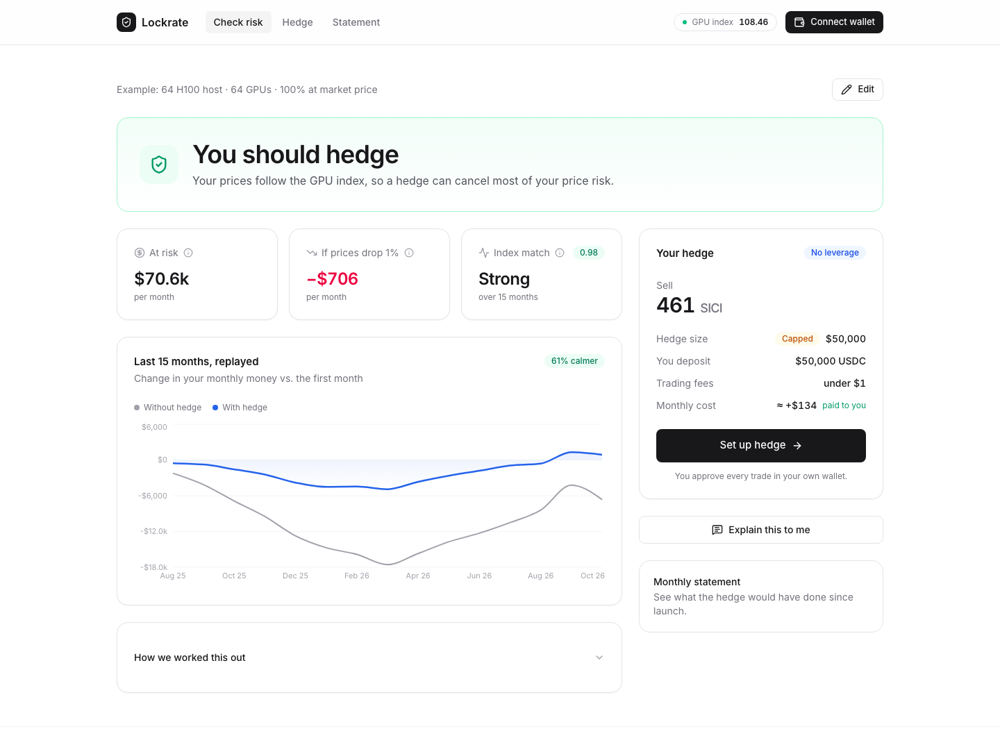
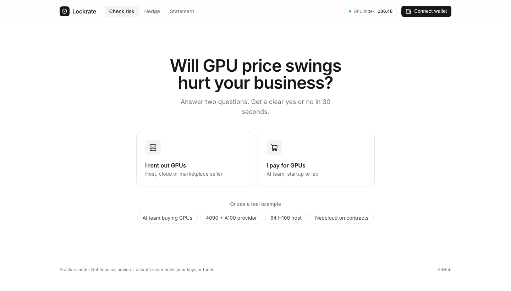
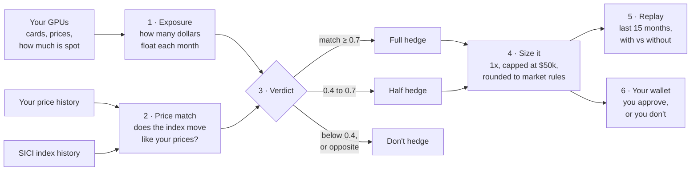

<div align="center">

# Lockrate

**Find out if you can protect your GPU income (or your GPU bill) from price swings, and by how much.**

[**Live app**](https://lockrate.vercel.app) · [How it works](docs/how-it-works.md) · [Architecture](docs/architecture.md) · [Research](docs/research.md)

[](https://github.com/Sakibimam/LockRate/actions/workflows/ci.yml)




</div>

---

## The problem

Renting out GPUs is a business where **the price changes every hour**. If you own 64 H100s and list them on a marketplace, the market decides what you earn. In the first half of 2026, H100 rental prices fell 20 to 40% from peak to trough. Nobody sent you a warning.

The same is true the other way round. If you're an AI startup paying for GPUs by the hour, a price spike can blow up your monthly bill.

Farmers solved this a century ago. A wheat farmer worried about falling prices *sells wheat futures*. If prices drop, the crop earns less but the futures earn more, and the two cancel out. That's a **hedge**.

Since October 2026 you can do the same for GPUs. Injective, a blockchain exchange, lists a contract that tracks a GPU rental price index called **SICI**. But there's a catch nobody talks about:

> **A hedge only works if the index moves like *your* prices.** If it doesn't, you haven't removed a risk. You've added a second bet.

Lockrate answers that question first, and half the time the honest answer is **"don't hedge."**

## What it does

You tell it about your GPUs. It tells you four things:

| Question | What you see |
| --- | --- |
| **How exposed am I?** | "$70,640 of your monthly income moves with market prices. A 1% drop costs you $706 a month." |
| **Would a hedge actually track me?** | A plain answer, *Strong*, *Some*, *Weak* or *Opposite*, worked out from your own price history. |
| **What exactly should I do?** | "Sell 463.6 SICI contracts with no leverage. You put up $50,000 in USDC." Or "Nothing for now." |
| **Would it have helped?** | The last 15 months replayed with and without the hedge, plus how much calmer your month-to-month numbers would have been. |

When you're ready, it builds the order and hands it to **your own wallet** to approve. Lockrate never holds your keys or your money.

## Who it's for

- **GPU hosts and small clouds** that rent out cards on marketplaces like Vast, RunPod, io.net or Akash. Your income floats with the market.
- **AI teams** that pay on-demand prices. Your costs float with the market, so you'd hedge the opposite way.
- **Not for lenders** using GPUs as loan collateral. Your risk is the value of the hardware over years, not monthly rental prices, and the app tells you so.

## Try it

**Online:** open **[lockrate.vercel.app](https://lockrate.vercel.app)**. Pick *I rent out GPUs* or *I pay for GPUs*, enter your cards, and you get an answer. Nothing is traded: the public site runs in practice mode.



Every example has its own link, so you can share a result: [64 H100 host](https://lockrate.vercel.app/?example=marketplace-host-64-h100) · [Neocloud on contracts](https://lockrate.vercel.app/?example=neocloud-80-contracted) · [4090 + A100 provider](https://lockrate.vercel.app/?example=decentralised-provider-4090) · [AI team](https://lockrate.vercel.app/?example=ai-team-inference-buyer)

**The four examples are worth clicking through.** They were picked to show every possible answer:

| Example | Moves with the market | Price match | Answer | Suggested hedge | Swings removed |
| --- | ---: | --- | --- | --- | ---: |
| Marketplace host, 64 H100s, all spot | $70.6k / month | 0.98 | **Hedge** | sell 463.6 SICI ($50k, hit the cap) | 61% |
| Neocloud, 512 cards, 80% on 1-year contracts | $158k / month | **−0.58** | **Don't hedge** | none | n/a |
| Decentralised 4090 + A100 provider | $38k / month | 0.55 | Small hedge | sell 174.4 SICI ($18.8k) | 12% |
| AI team buying on-demand H100/H200 | $36k / month | 0.93 | **Hedge** | buy 284.9 SICI ($30.7k) | 62% |

The neocloud is the whole point of the project. Its contract prices **rose** while spot prices **fell**. A SICI hedge would have lost money exactly when the business did. Most tools would have sold it a hedge anyway.

*Numbers computed by the engine on the data in this repo, priced at the 10 Nov 2026 close of 107.84.*

## How it works



1. **Exposure.** Cards × hours in use × price per hour × the share that isn't locked into a fixed contract. That's the money that moves with the market.
2. **Price match.** We compare how your prices and the index changed month to month. A perfect match scores 1. Moving in opposite directions scores −1.
3. **Verdict.** 0.7 or above means hedge. 0.4 to 0.7 means a half-size hedge. Anything lower means don't. If your prices move *against* the index, the answer is always no.
4. **Size.** Your floating dollars × how strongly your prices react to the index, capped at $50,000 and with **no leverage, ever**.
5. **Replay.** We run the plan over real history so you can see what it would have done, including the months it lost money.
6. **Sign.** Optional, off by default. The order is built and checked, then your wallet asks you to approve it.

The full maths, with a worked example a non-trader can follow, is in **[docs/how-it-works.md](docs/how-it-works.md)**.

## Run it yourself

You need **Node 20+** and **pnpm**. Setup takes about a minute.

```bash
git clone https://github.com/Sakibimam/LockRate.git
cd LockRate
pnpm install
cp .env.example .env.local
pnpm dev
```

Open **http://localhost:3000**. It works with no keys at all.

| Command | What it does |
| --- | --- |
| `pnpm dev` | Runs the app at localhost:3000 with live reload |
| `pnpm test` | Runs the 41 engine tests, including all four examples end to end |
| `pnpm typecheck` | Type-checks every package |
| `pnpm build` | Production build of everything |
| `pnpm snapshot` | Pulls fresh SICI daily prices from Injective mainnet into `data/` |

### Settings

All optional. Defaults are safe.

| Variable | Default | What it does |
| --- | --- | --- |
| `LOCKRATE_LIVE` | `0` | `1` switches on trading on the *Hedge* page. Leave it off unless you mean it. |
| `INJECTIVE_NETWORK` | `mainnet` | `mainnet` or `testnet` |
| `SICI_MARKET_ID` | SICI/USDC perp | The market to read and trade |
| `MAX_NOTIONAL_USD` | `50000` | Largest hedge the app will ever build |
| `MAX_PREMIUM_USD_PER_MONTH` | `2000` | Budget cap for options, once they reach mainnet |
| `STALE_DATA_MINUTES` | `180` | Refuses to plan an order if the last trade is older than this |
| `ANTHROPIC_API_KEY` | none | Turns on *Explain this to me* and *Fill from a price list*. Everything else works without it. |

Leverage isn't in this list on purpose. It's fixed at 1x in code and can't be raised through config.

## What's inside

```
lockrate/
├── apps/web/               the website (Next.js 16, React 19, Tailwind 4, Radix UI)
│   ├── app/                pages: risk check, place a hedge, monthly statement
│   │   └── api/            sici (live market), explain + parse (optional AI)
│   ├── components/         the screens: start, your GPUs, result, hedge, statement
│   │   └── ui/             shadcn-style building blocks on Radix (button, card, slider…)
│   └── lib/                reads data/, saves your inputs in the browser, wallet
├── packages/
│   ├── engine/             all the maths. zero dependencies, 41 tests
│   ├── injective/          reads the SICI market, builds unsigned orders
│   └── explain/            optional AI: plain-language summaries, rate card reading
├── data/                   real SICI prices, example price histories, example profiles
└── docs/                   how it works, architecture, research, demo script
```

**One rule holds the design together:** every number that could drive a trade comes from `packages/engine`. It's plain TypeScript with no dependencies, it's tested, and the website and the tests call the same `run()` function. The AI package can describe numbers, and it can read a pasted invoice into the form for you to confirm. It can never produce a number that ends up in an order.

More detail, with diagrams, is in **[docs/architecture.md](docs/architecture.md)**.

## Safety

This touches real money, so the guardrails are in code, not in good intentions:

- **Practice mode by default.** The *Hedge* page can't trade until someone sets `LOCKRATE_LIVE=1`.
- **No leverage.** 1x is hard-coded.
- **Hard size cap.** Checked when the plan is made, and checked again when the order is built.
- **Stale-data guard.** No order if the market hasn't traded recently.
- **Non-custodial.** You sign in Keplr or Leap. Lockrate never sees a private key.
- **"Don't hedge" is a first-class answer.** Opposite-moving prices always get a no, whatever the score says.

Found a security problem? See [SECURITY.md](SECURITY.md).

## Honest limitations

- **Short history.** SICI started trading on 26 Oct 2026, so there are only 15 days of real prices. Months before that use a reconstruction from the index's published card weights, clearly labelled in [`data/README.md`](data/README.md).
- **Thin market.** Around $500k a day traded in the first two weeks. That's why the $50k cap exists.
- **Fixed-size replay.** The replay holds one position the whole time. Re-sizing monthly would do better, and it's on the list.
- **Options are preview-only.** SICI options are on testnet, so they aren't in the order builder yet.

## Deploying

It runs on Vercel with no special setup beyond one setting:

1. Import the repo into Vercel.
2. Set **Root Directory** to `apps/web`. This matters: the app lives in a subfolder, and builds from the repo root fail with `No Next.js version detected`.
3. Add any of the settings above as environment variables, then deploy.

If Root Directory is left at the repo root, the `vercel.json` there switches off Git-triggered deploys so pushes don't produce failed builds. Once you set `apps/web`, Vercel ignores that file and every push to `main` deploys.

To deploy by hand from your machine:

```bash
vercel build --prod && vercel deploy --prebuilt --prod
```

The `data/` folder is bundled into the server automatically (see `apps/web/next.config.ts`), so it needs no database. The trade-off is that refreshing SICI prices means running `pnpm snapshot` and redeploying.

## Roadmap

- [ ] Open and close a small real position from the live page, and post the transaction links here
- [ ] SICI options in the planner and order builder once they reach mainnet
- [ ] Re-size the hedge monthly in the replay
- [ ] Replace the reconstructed history with official LO:TECH index data
- [ ] Pilot with 3 to 5 operators using real revenue files
- [ ] Hourly price refresh without a redeploy

The full list, in the order I'd fix things, is in [docs/production-checklist.md](docs/production-checklist.md).

## FAQ

<details>
<summary><b>Is this financial advice?</b></summary>

No. It's a calculator with opinions. It shows its working so you can check it, and it never trades without your signature.
</details>

<details>
<summary><b>Why would it tell me <i>not</i> to hedge?</b></summary>

Because a hedge on an index that doesn't follow your prices isn't protection. It's a second, unrelated bet. The neocloud example shows this: a SICI hedge would have lost money in the same months the business did.
</details>

<details>
<summary><b>Do I need crypto to use it?</b></summary>

Not to get the answer. The risk check, the replay and the monthly statement need nothing. You only need an Injective wallet with USDC if you decide to place the hedge.
</details>

<details>
<summary><b>Can I use my own prices instead of the examples?</b></summary>

Yes. On the *Your GPUs* step, open *More options*, set *Your past prices* to "Paste my own", and paste one month per line, like `2026-03, 2.15`. You need at least 3 months, and 6 or more for a confident answer.
</details>

<details>
<summary><b>What does the AI do, exactly?</b></summary>

Two optional things. It writes a plain-English summary of results the engine already computed, and it reads a pasted rate card into the form, showing the phrase each number came from. Nothing is applied until you click to confirm. It never picks a trade size.
</details>

<details>
<summary><b>Why Injective and not CME or Kalshi?</b></summary>

Access. A GPU host in Bangalore or Bangkok can install a wallet in five minutes but can't open a US futures account. [docs/research.md](docs/research.md) compares every venue.
</details>

## Glossary

| Term | Meaning |
| --- | --- |
| **Hedge** | A position that makes money when your business loses it, so the two roughly cancel out |
| **SICI** | A GPU rental price index: H100 40%, B200 25%, H200 15%, A100 10%, RTX 4090 10%. Based at 100 on 22 Jul 2026. |
| **Perp (perpetual)** | A contract that tracks a price and never expires. You can close it whenever you like. |
| **Spot share** | The part of your income or bill that follows market prices, rather than a fixed contract |
| **Price match (correlation)** | How closely two prices move together month to month, from −1 to +1 |
| **Beta** | How *strongly* your price reacts when the index moves. Used to size the hedge. |
| **Funding** | A small hourly payment between buyers and sellers of a perp. It keeps the perp's price close to the index. |
| **1x / no leverage** | You put up the full value of the position, so there's no borrowing and no margin calls |
| **Notional** | The total dollar value of a position |

## Docs

| File | Read it if you want… |
| --- | --- |
| [docs/how-it-works.md](docs/how-it-works.md) | the maths, step by step, with a worked example |
| [docs/architecture.md](docs/architecture.md) | how the code fits together, with diagrams |
| [docs/research.md](docs/research.md) | every competing venue and index, and who actually needs this |
| [docs/demo.md](docs/demo.md) | a two-minute walkthrough script |
| [docs/production-checklist.md](docs/production-checklist.md) | what's done and what's missing before real money |
| [data/README.md](data/README.md) | where every data file came from |
| [CONTRIBUTING.md](CONTRIBUTING.md) | how to run, test and send changes |

## License

[MIT](LICENSE). Use it, fork it, ship it.

<sub>Lockrate measures exposure and builds hedges you sign yourself. It isn't financial advice. SICI markets are young and thin. Check what applies where you live.</sub>
