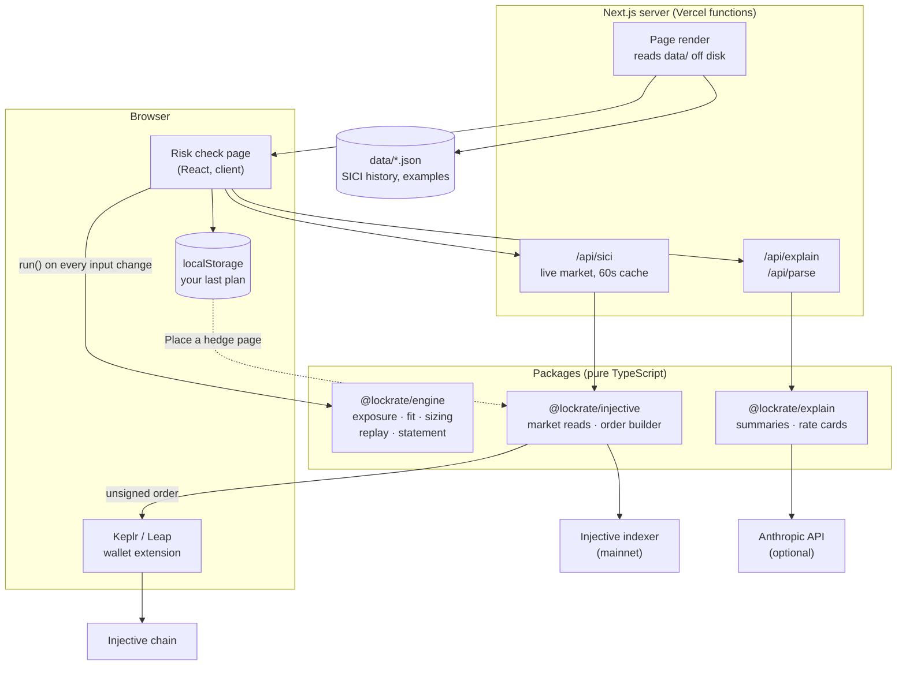
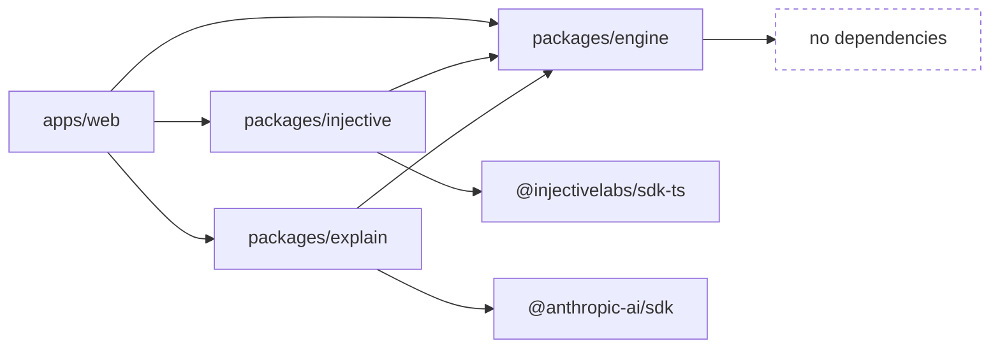
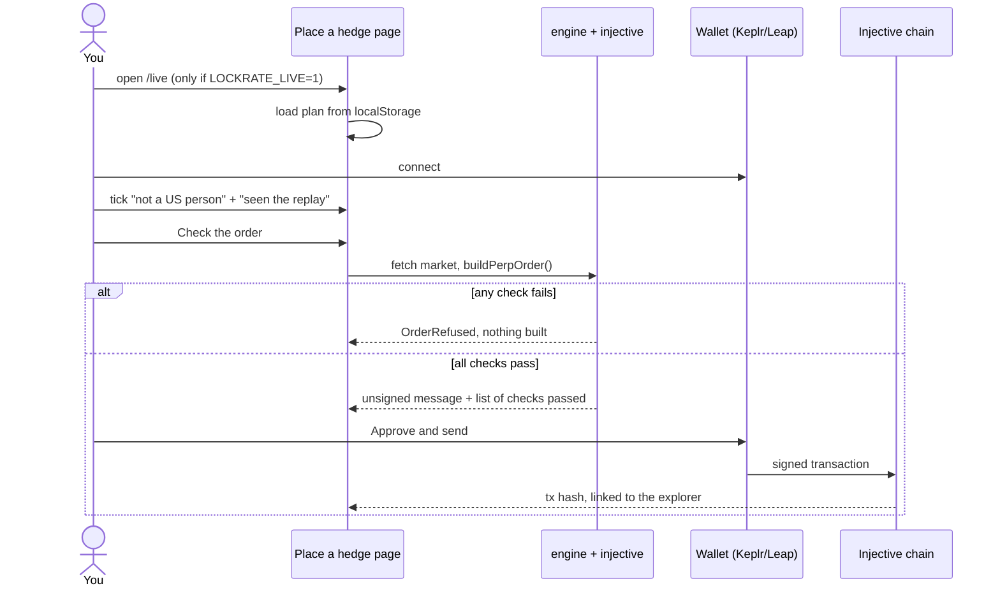

# Architecture

How the code fits together, and why it's shaped this way. For the maths itself, see [how-it-works.md](how-it-works.md).

## The big picture



The important arrow is the one that **isn't** there. Nothing leads from the AI package to the order builder.

## Packages

It's a **pnpm workspace** with one app and three packages. The packages ship as TypeScript source (no build step), and Next.js compiles them through `transpilePackages`.



### `packages/engine` — every number that matters

| File | Job |
| --- | --- |
| `exposure.ts` | Fleet → GPU-hours → dollars floating per month, and per 1% move |
| `fit.ts` | Price match (Pearson correlation of monthly % changes), beta, verdict |
| `sizing.ts` | Verdict + beta + caps → side, contracts, margin, fees, funding |
| `simulate.ts` | Replays a plan over history: with and without the hedge |
| `report.ts` | The monthly statement |
| `limits.ts` | Reads caps from env, with leverage pinned at 1. Stale-data guard. |
| `basket.ts` | SICI card weights |
| `stats.ts` | mean, stdev, pearson, slope. Hand-written, so every line can be audited. |
| `pipeline.ts` | `run()`, which chains all of the above. The app and the tests both call this. |

**Zero runtime dependencies, on purpose.** Anyone checking whether a hedge size is right only has to read about 700 lines of plain TypeScript. There are 41 tests in `packages/engine/test/`.

### `packages/injective` — talking to the market

- **`SiciClient`** reads market info, the latest trades, the oracle price, funding and an open position. It uses the Injective indexer's gRPC and REST (chronos) APIs.
- **`buildPerpOrder()`** turns a plan into an **unsigned** `MsgCreateDerivativeMarketOrderV2`. It re-checks everything first and throws `OrderRefused` on: non-perp instrument, zero size, leverage above 1x, an inactive market, size rounding to zero, or size above the cap.
- **`buildClosePerpOrder()`** builds a reduce-only order on the opposite side, so it can only shrink a position, never flip it.
- **`scripts/snapshot.ts`** (`pnpm snapshot`) refreshes `data/sici-daily.json`. It tries chronos candles first, and falls back to bucketing raw trades by UTC day, because chronos was down for most of launch week.

### `packages/explain` — optional AI, kept on a leash

- **`explainVerdict()`** writes a plain-English summary *from numbers the engine already computed*.
- **`parseRateCard()`** reads pasted text into a draft profile, validated with Zod. Every field carries the phrase it came from, and the UI applies nothing until the user clicks to confirm.
- If there's no API key, both API routes return `503` and the UI says the feature isn't set up. Everything else keeps working.

### `apps/web` — the website

| Route | Type | What it does |
| --- | --- | --- |
| `/` | dynamic page | Loads example profiles and price histories from `data/`, then hands them to the client dashboard |
| `/live` | dynamic page | *Place a hedge*. Shows "switched off" unless `LOCKRATE_LIVE=1`. |
| `/report` | dynamic page | Monthly statement from the plan saved in localStorage |
| `/api/sici` | Node function | Live market snapshot. Cached 60s. Falls back to the last saved close if the indexer is down. |
| `/api/explain` | Node function | AI summary, 60s timeout |
| `/api/parse` | Node function | AI rate-card reader, 60s timeout |

**Where the maths runs:** in the browser. `Dashboard.tsx` calls `run()` from the engine on every keystroke, so dragging a slider updates the answer instantly with no server round trip. The server only provides data and the live market price.

## What happens when you open the page

```mermaid
sequenceDiagram
    participant B as Browser
    participant S as Next.js server
    participant D as data/
    participant I as Injective indexer

    B->>S: GET /
    S->>D: read sici-daily.json, proxies/, profiles/
    S-->>B: HTML + example data
    B->>B: run() with saved last close → first answer
    B->>S: GET /api/sici
    S->>I: market, trades, oracle, funding
    I-->>S: live snapshot
    S-->>B: price, fees, funding, freshness
    B->>B: run() again with the live price
    B->>B: save plan to localStorage
```



## What happens when you place a hedge



## Design decisions

| Decision | Why |
| --- | --- |
| **The engine has no dependencies** | It's the only code that decides trade sizes. Small and readable beats clever. |
| **"Don't hedge" is a first-class result** | The most valuable thing the tool does is stop a bad hedge. Negative beta always forces a skip. |
| **1x leverage is hard-coded** | It's insurance, not a trade. No setting can raise it. |
| **Caps are checked twice** | Once when the plan is made, once when the order is built, so a stale plan in localStorage can't sneak past. |
| **AI never touches a number that trades** | Models can misread and miscount. They describe results and draft form inputs that you confirm. They never size orders. |
| **Data lives in JSON files, not a database** | Around 44 KB of data that changes daily. Files are diffable, reviewable and free. The trade-off is a redeploy to refresh. |
| **Maths runs in the browser** | Instant feedback while you drag sliders, and nothing about your business is sent to a server. |
| **No custody** | Orders are built unsigned and signed in your wallet. There's no backend that could lose keys. |

## Deployment notes

- **Vercel:** Root Directory must be `apps/web`.
- `data/` sits *outside* `apps/web`, and Next.js can't see a file read at runtime. So `next.config.ts` lists `../../data/**/*.json` under `outputFileTracingIncludes`, which copies the files into every serverless function. Without that line every page crashes with `could not find data/ directory`.
- The root `vercel.json` skips builds for commits that only touch docs.
- Serverless filesystems are read-only, so `pnpm snapshot` has to run somewhere else, for example a local machine or a CI job, followed by a redeploy.

## Testing

```bash
pnpm test        # vitest, 41 tests, ~150ms
pnpm typecheck   # tsc across all packages
```

| Test file | Covers |
| --- | --- |
| `exposure.test.ts` | hours, rates, spot share, cards outside the index |
| `fit.test.ts` | correlation, beta, thresholds, negative-beta skip, short history |
| `sizing.test.ts` | coverage, caps, tick rounding, fees, funding sign |
| `simulate.test.ts` | replay maths, cost of hedge |
| `limits.test.ts` | env parsing, leverage pinned at 1, stale guard |
| `report.test.ts` | monthly statement |
| `stats.test.ts` | the hand-written stats helpers |
| `profiles.test.ts` | all four example businesses end to end, including "the neocloud would have been hurt by hedging" |

CI runs typecheck, tests and a production build on every push. See `.github/workflows/ci.yml`.
